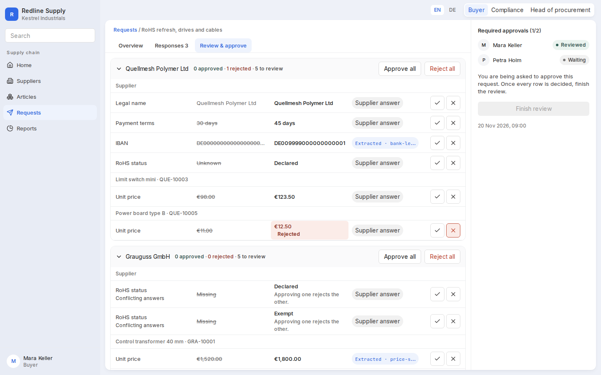
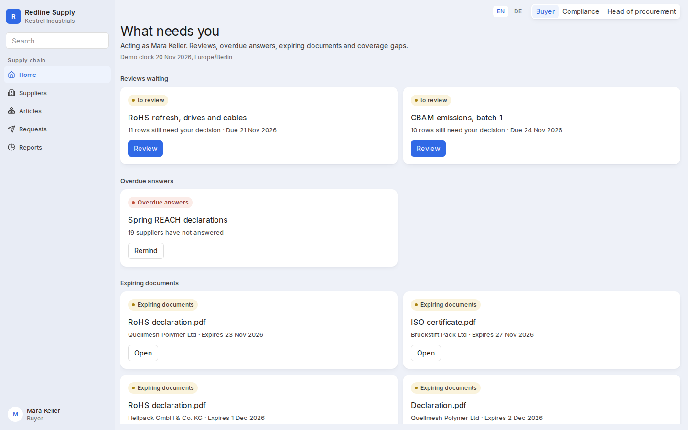
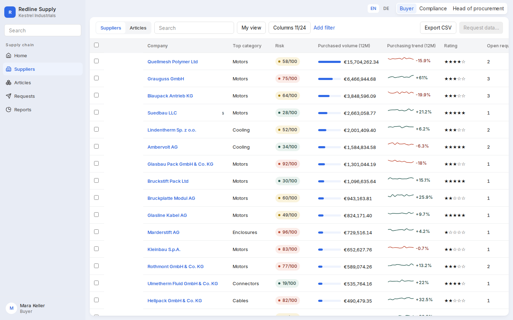
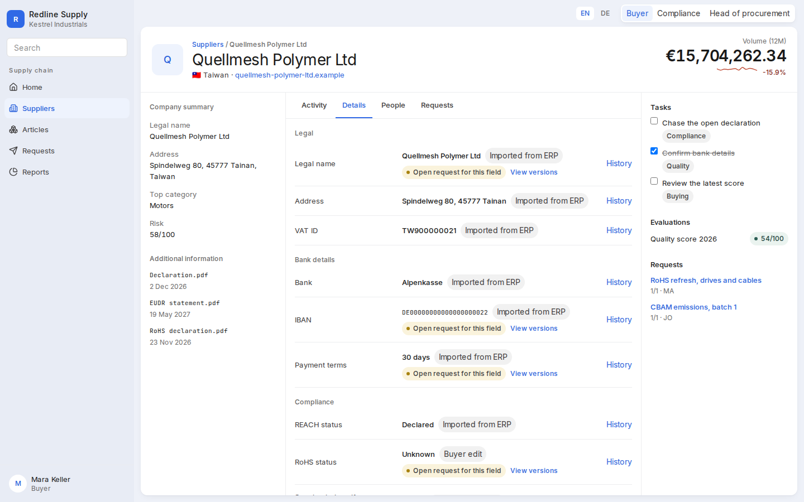
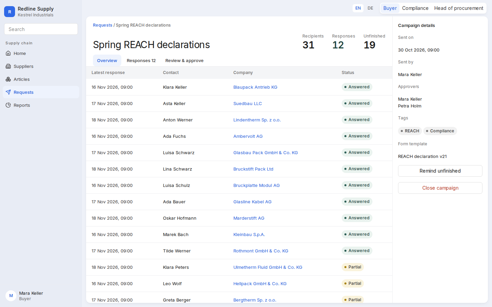
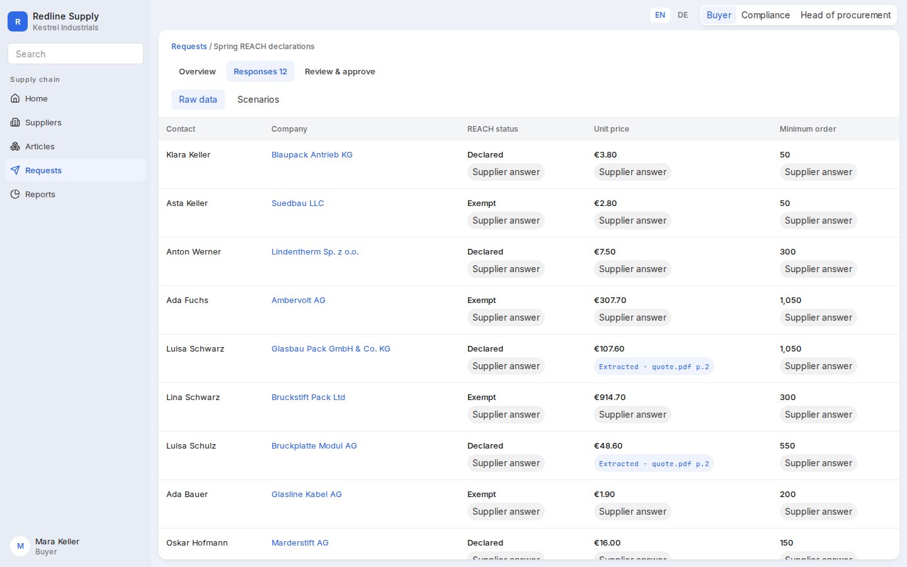
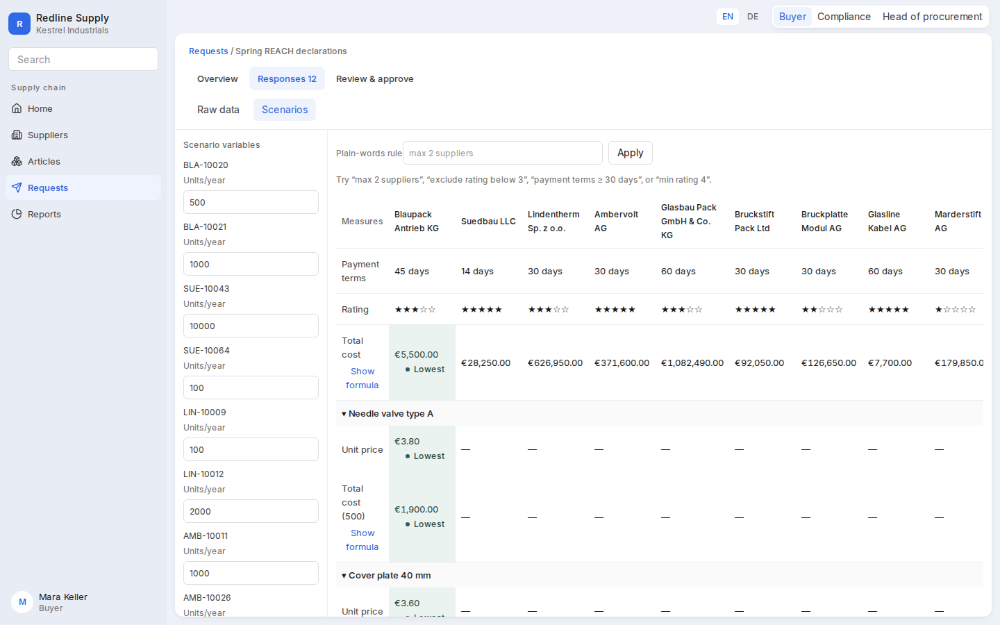
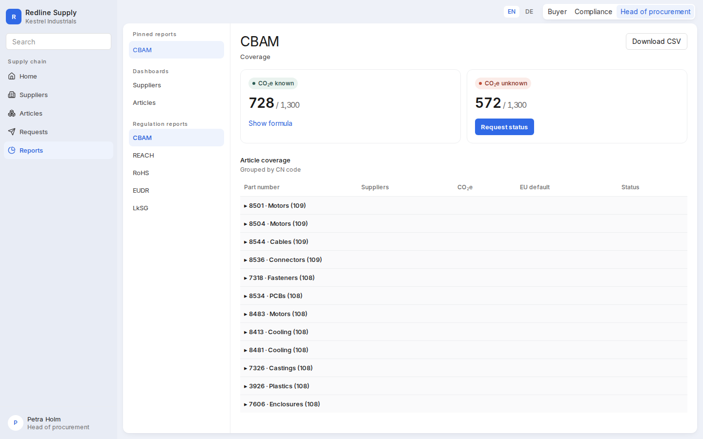

# Redline Supply

> Ask suppliers once. Approve every change. Keep the history.



Live demo: [redline-supply-seven.vercel.app](https://redline-supply-seven.vercel.app)

## The problem

Procurement teams in mid-sized manufacturers chase supplier data (compliance declarations, prices, certificates, bank details) through email and spreadsheets. Answers arrive in any format, get re-typed into master data, and nobody can say later who changed what, or based on which document.

## Who it's for

- **Buyers / category managers**: send one request, compare the answers, award with the math visible.
- **Compliance managers**: see coverage for REACH, RoHS, CBAM, EUDR and supply-chain due diligence, and request what's missing in one click.
- **Heads of procurement**: approve sensitive changes with a clear before/after and an audit trail.

## What it solves

| Problem | How the prototype answers it | Screen |
|---|---|---|
| "Who hasn't answered?" | Campaign with live counters and recipient states | Campaign |
| "Which quote is really cheaper at our volumes?" | Scenario grid with editable volumes and visible formulas | Responses |
| "Did a supplier just change our bank details?" | Field-level review, two approvers for sensitive fields | Review |
| "Where did this value come from?" | Source chip and version history on every field | Supplier |
| "How far are we on CBAM?" | Coverage report that turns gaps into a request | Reports |

## Competitor landscape

| Product | What they are known for | Link |
|---|---|---|
| Mercanis | Supplier collaboration and source-to-contract workflows | [mercanis.com](https://mercanis.com) |
| Sievo | Procurement analytics and spend visibility | [sievo.com](https://sievo.com) |
| Archlet | Scenario comparison during sourcing | [archlet.io](https://www.archlet.io) |
| Keelvar | Sourcing optimisation | [keelvar.com](https://www.keelvar.com) |
| Pactum | Autonomous supplier negotiations | [pactum.com](https://pactum.com) |
| IntegrityNext | Sustainability and due-diligence monitoring | [integritynext.com](https://www.integritynext.com) |
| Scoutbee | Supplier discovery | [scoutbee.com](https://scoutbee.com) |

## Screens

Home. What is waiting for the person signed in as buyer, compliance or head of procurement.



Suppliers. Saved views, filters, a column picker and bulk "Request data".



Supplier. Activity, field sources and version history.



Campaign. Recipients, responses and what is still open.



Responses. Raw answers, then scenarios with the formula next to the total.





Review and approve. The current value, the proposal, and a decision on each row.


Coverage. Known against unknown, and a request that starts from the gap.



## Design principles

- No silent overwrites
- Every value has a source
- Math you can see
- Ask fewer suppliers, better

## How the data works

All data is synthetic and seeded: 64 invented suppliers and 1,300 articles. Supplier answers and "document extraction" are deterministic fixtures, not an AI call. See `lib/mock` and `lib/extract`.

Decisions you make in the browser stay in local storage. "Reset demo" in the account menu puts the seed back.

## Tech

Next.js · TypeScript · Tailwind · shadcn/ui · TanStack Table · Recharts · Vitest · Playwright · Vercel

## Run locally

```bash
npm i && npm run data && npm run dev
```

## Roadmap

[DENYS: what you want to build next]. Ideas: a real supplier-facing form, LLM extraction behind `lib/extract`, ERP import, email reminders.

## License

MIT. Copyright 2026 Denys Sergushkin.
